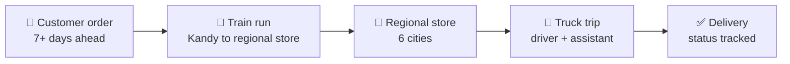

# Kandypack Logistics Platform

**Rail and Road-based Supply Chain Distribution System** · Group 24 · Database Systems project


Kandypack is an FMCG manufacturer in Kandy, Sri Lanka. This platform replaces its
spreadsheet tracking with a database-driven system that moves an order from the customer,
onto a train to one of six regional stores, and out on a truck to the customer's door.



The business rules live **inside the database** (stored procedures, triggers and
constraints), so they hold for the web app, the API and direct SQL alike.

---

## Setup

The whole system (database, backend and web interface) starts with Docker Compose.

### What you need

| Tool | Notes |
|---|---|
| [Docker Desktop](https://www.docker.com/products/docker-desktop/) | Must be running before you start |
| [Git](https://git-scm.com/) | To clone the repository |
| Free ports **80**, **8080**, **3307** | Web interface, backend API, MySQL |

You do not need Java, Maven, Node.js or MySQL installed. Docker builds and runs all of it.

### Step 1 · Get the code

```sh
git clone https://github.com/therealoshii/Kandypack-Logistics-Platform.git
cd Kandypack-Logistics-Platform
```

### Step 2 · Create your `.env` file

> [!IMPORTANT]
> Passwords are never stored in this repository. You choose them yourself in a `.env` file,
> which is git-ignored. The system will not start without it.

Copy the template:

```sh
cp .env.example .env
```

On Windows PowerShell:

```powershell
Copy-Item .env.example .env
```

Open `.env` and set the two passwords:

| Variable | What it is | Rule |
|---|---|---|
| `DB_ROOT_PASSWORD` | Password of the MySQL `root` user | Any value; avoid `$`, `#` and spaces |
| `BOOTSTRAP_ADMIN_PASSWORD` | Password of the first staff account, `admin` | **12 to 72 characters** |

### Step 3 · Start the system

```sh
docker compose up --build -d
```

The first build downloads the Maven and npm dependencies and can take several minutes.
The database is created and filled with test data automatically.

### Step 4 · Check that it is running

```sh
docker compose ps
```

All three services should be listed as running, and `kandypack-mysql` as **healthy**.

### Step 5 · Sign in

| Open | Address | Sign in with |
|---|---|---|
| **Staff workspace** | <http://localhost> | `admin` and your `BOOTSTRAP_ADMIN_PASSWORD` |
| **Customer portal** | <http://localhost/portal/login> | "Create an account", or a seeded customer |
| Backend API | <http://localhost:8080/api> | Session cookie from the login |
| MySQL | `localhost:3307`, database `kandypack_db` | `root` and your `DB_ROOT_PASSWORD` |

The seeded customers (for example `lankasuper_col`) share one demo password. It is written
in the comment above the customer rows in `database/seed/01_seed_core.sql`.

More staff accounts, with other roles, are created by `admin` on the **Staff & roles** page.

### Stopping and resetting

| To | Run |
|---|---|
| Stop, keeping the data | `docker compose down` |
| Start again | `docker compose up -d` |
| Rebuild after pulling new code | `docker compose up --build -d` |
| Reset the database to the seed | `docker compose down -v`, then `docker compose up --build -d` |

> [!WARNING]
> `docker compose down -v` deletes the local database. The seed rebuilds it on the next
> start, but anything you entered yourself is lost.

### If something goes wrong

| What you see | Cause | Fix |
|---|---|---|
| `Set DB_ROOT_PASSWORD in .env` or `Set BOOTSTRAP_ADMIN_PASSWORD in .env` | `.env` is missing or a value is empty | Do step 2 |
| `port is already allocated` | Another program uses port 80, 8080 or 3307 | Stop that program, or change the left-hand port in `docker-compose.yml` |
| Build stops with `Could not transfer artifact` | The download from Maven Central was interrupted | Run `docker compose up --build -d` again |
| `admin` cannot sign in | The password in `.env` was changed after the database was built, or is not 12 to 72 characters | Fix `.env`, then reset the database |
| Backend keeps restarting with `Access denied` | `DB_ROOT_PASSWORD` was changed after the database was built | Put the old value back, or reset the database |
| A page shows old behaviour after pulling | The containers were not rebuilt | `docker compose up --build -d` |

To read the logs:

```sh
docker logs kandypack-backend
docker logs kandypack-mysql
```

---

## Modules and owners

Each member owns one slice end to end: tables, stored logic, API and page.

| Member | Module | Main database objects | Page |
|---|---|---|---|
| **Haneef** | Customers and orders | `sp_place_order`, `fn_get_route_for_address` | Order placement, customer portal |
| **Widushi** | Rail cargo and shipments | `sp_schedule_order`, `sp_schedule_shipment`, `trg_check_cargo_capacity` | Train cargo dispatch |
| **Shameera** | Stores, routes and fleet | `vw_truck_utilization`, fleet and geographic reports | Store and fleet hub |
| **Oshan** | Roster, trips and deliveries | `sp_check_*` rule procedures, `sp_assign_truck_trip`, `sp_assign_delivery`, `sp_update_delivery_status` | Roster and dispatch |
| **Aathiththan** | Reports and administration | Sales reports, `trg_audit_log`, indexes, `run_all.sql` | Analytics, reports, login |

The full file-by-file allocation is in
[`database_file_allocation.md`](docs/Project-Documentation/database_file_allocation.md).

## Rules the database enforces

| Rule | Enforced by |
|---|---|
| Orders are placed at least **7 days** before delivery | `sp_place_order` and a `CHECK` on `Orders` |
| An order's route is the route of the customer's **delivery area** | `fn_get_route_for_address` and foreign keys |
| An order lists each product **once**; repeated products are added together | `sp_place_order`, `UNIQUE (OrderID, ProductID)` |
| A train run is **never overbooked**; overflow rolls to the next run | `trg_check_cargo_capacity`, `sp_ship_order_line` |
| A whole order goes onto trains **in one step**, or not at all | `sp_schedule_order` |
| A truck only serves routes from **its own store**, within the route's maximum time | `sp_check_trip_route` |
| No overlapping bookings for a truck, driver or assistant | `sp_check_schedule_conflict` |
| A driver never works **two consecutive trips** (30-minute rest) | `sp_check_driver_consecutive` |
| An assistant works at most **two consecutive trips** | `sp_check_assistant_consecutive` |
| Drivers **40 hours** a week, assistants **60 hours** | `sp_check_weekly_hours` |
| A whole order goes on **one truck trip**, on its route and date, after it **arrives by train** | `sp_assign_delivery`, `sp_check_delivery` |
| Status and trip changes are **audited with the username** | `trg_audit_log` |

A broken rule is raised as `SQLSTATE 45000` with its own message. The API returns it as
HTTP 400 and the page shows that message.

## Who can do what

| Role | Access |
|---|---|
| `ADMIN` | Everything, including staff accounts and roles |
| `ORDER_MANAGER` | Customers, products and orders |
| `RAIL_DISPATCHER` | Train schedules and shipment scheduling |
| `FLEET_MANAGER` | Stores, routes, trucks and the fleet usage report |
| `ROSTER_DISPATCHER` | Trips, drivers, assistants and deliveries |
| `ANALYST` | All reports, read-only |
| `CUSTOMER` | The customer portal only: own profile and own orders |

Staff and customers sign in separately. Details are in
[`backend/README-SECURITY.md`](backend/README-SECURITY.md).

---

## Repository layout

```text
├── backend/            Spring Boot REST API (Java 17, Maven)
├── frontend/           React + TypeScript web interface (Vite, served by nginx in Docker)
├── database/
│   ├── schema/         Tables, keys and CHECK constraints
│   ├── functions/      Space, capacity, weekly hours, route lookup
│   ├── procedures/     Order placement, shipment scheduling, trip and delivery rules
│   ├── reports/        Report procedures
│   ├── triggers/       Capacity, roster, delivery and audit triggers
│   ├── indexes/  views/
│   ├── seed/           Test data
│   ├── tests/          SQL test scripts
│   └── run_all.sql     Builds the whole database in the right order
├── docs/               SRS, ER diagram and module specifications
├── docker-compose.yml  Database + backend + web interface
└── .env.example        Template for your local passwords
```

## Seed data

| | |
|---|---|
| **Network** | 6 stores, 12 last-mile routes, 36 delivery areas |
| **Rail** | 3 trains, 12 weekly schedules (two per city) |
| **Fleet and crew** | 12 trucks, 10 drivers, 10 assistants |
| **Catalogue** | 10 products, 12 customers |
| **Orders** | 55 orders across April to October 2026, including one that rolls over three train runs |

## Tests

The SQL test scripts are in `database/tests/`.

| Script | Checks |
|---|---|
| `test_seed_integrity.sql` | 20 checks that the data breaks no rule. Read-only; every row must show `0` |
| `test_lead_time.sql` | The 7-day lead time and route matching |
| `test_capacity_overflow.sql` | An order splitting 300 / 300 / 100 across three train runs |
| `test_roster_violations.sql` | 11 negative cases, one per roster and delivery rule |

Run one against the running stack:

```sh
docker exec kandypack-mysql sh -c 'MYSQL_PWD=$MYSQL_ROOT_PASSWORD mysql -uroot -t kandypack_db < /docker-entrypoint-initdb.d/tests/test_seed_integrity.sql'
```

> [!NOTE]
> Only the integrity script is read-only. The other three insert test trips and orders,
> so run them on a database you are happy to rebuild.

## Reports

Quarterly sales · Top items · City and route sales · Working hours · Staff weekly hours ·
Fleet usage · Customer order history

Reports open on the Reports page, by role, and six of them download as PDF.

## Documentation

| Document | Location |
|---|---|
| Software Requirements Specification, version 2.1 | [`docs/SRS/`](docs/SRS) |
| ER diagram | [`docs/ER-Diagram/`](docs/ER-Diagram) |
| Rail cargo specification | [`rail_cargo_specification.md`](docs/Project-Documentation/rail_cargo_specification.md) |
| Roster, trip and delivery specification | [`roster_delivery_specification.md`](docs/Project-Documentation/roster_delivery_specification.md) |
| Customer order and portal specification | [`order_portal_specification.md`](docs/Project-Documentation/order_portal_specification.md) |
| Route and delivery area specification | [`route_delivery_area_specification.md`](docs/Project-Documentation/route_delivery_area_specification.md) |
| Database file allocation | [`database_file_allocation.md`](docs/Project-Documentation/database_file_allocation.md) |
| Staff login, roles and administrator bootstrap | [`backend/README-SECURITY.md`](backend/README-SECURITY.md) |
| Cloud deployment on Azure | [`README-DEPLOYMENT.md`](README-DEPLOYMENT.md) |

---

## Running without Docker

For development you can run the backend and web interface directly. You need JDK 17 or
later, Node.js, and a MySQL 8 database built from `database/run_all.sql`.

```powershell
# Backend, from backend/
$env:DB_PASSWORD = "your-mysql-password"
$env:BOOTSTRAP_ADMIN_PASSWORD = "a-password-of-12-or-more-characters"
.\mvnw.cmd spring-boot:run
```

```sh
# Web interface, from frontend/
npm install
npm run dev
```

The web interface runs on <http://127.0.0.1:5173> and forwards `/api` to the backend on
port 8080. The backend expects MySQL on `localhost:3306`; set `SPRING_DATASOURCE_URL` to
use another address.

## Git workflow

Each member works on their own branch and opens a pull request into `dev2`, the
integration branch. `main` holds the submitted release.

## Team

Group 24 · Department of Computer Science and Engineering, University of Moratuwa

| Member | GitHub | Module |
|---|---|---|
| Haneef H. M. | [@mohamedhaneef22](https://github.com/mohamedhaneef22) | Customers and orders |
| Kawya W. W. D. | [@widushiwickramage](https://github.com/widushiwickramage) | Rail cargo and shipments |
| Shameera M. N. F. | [@fathimashameera1234](https://github.com/fathimashameera1234) | Stores, routes and fleet |
| Vithanage K. O. | [@therealoshii](https://github.com/therealoshii) | Roster, trips and deliveries |
| Aathiththan K. | [@Ihtaa2004](https://github.com/Ihtaa2004) | Reports and administration |
